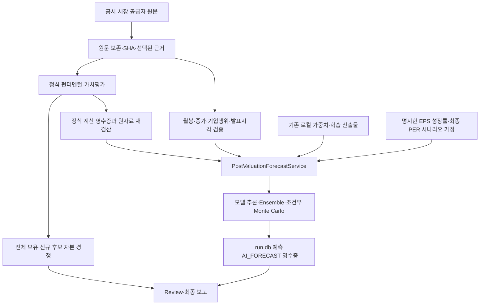

# AI 예측 엔진 통합 안내

GitHub main의 집중 자본배분 정책을 유지하면서 기존 로컬 AI 엔진을 연결한 통합 후보입니다. 최종 검증 상태는 IMPLEMENTATION_STATUS.md를 확인하세요.

## 실제 연결

AI 결과는 별도 보고 자료로 연결됩니다. 성장성 등 여섯 차원의 점수, 기존 시나리오 CAGR, 순위·승인·회전 판단에는 입력하지 않습니다. `execution/capital_competition.py:render_capital_competition`은 forecast_companion을 읽기 전용으로 렌더링합니다. `execution/analysis_modes.py`의 연구 경로는 `PostValuationForecastService.run_for_instruments`를 가치평가 이후 호출하고 계산·근거 ID와 검토 사유를 보고로 전달합니다.

## 데이터의 자격

`execution/forecast_source.py`와 `providers/yahoo_native_months.py`가 원자료를 처리합니다. Yahoo Chart 원생 월봉 계약은 `interval=1mo&range=5y&events=div,splits`입니다. 기간 시작의 불완전 월, 마지막 미완성 월, 현재 quote 행을 제외하고 현지 civil 월말로 정렬합니다. 가격·시간대·상장종목·통화·원문 SHA·누락·중복·미래값을 검사합니다. Chronos 최소16개월, Kronos 최소32개월 조건이 있습니다. 전체 5년을 모두 확보했다는 표현과 구분해야 합니다.

별도의 최신 일봉 종가와 월봉 응답 최신 시장시각·가격을 결속합니다. 관측시각과 provider의 발표·스냅샷시각이 다르면 둘을 각각 검사합니다. 종가16:00, 발표16:00:01이면 cutoff16:00:00.5에서는 사용할 수 없습니다. source SHA는 보관 중 변조 검증이며 공급자가 내용을 외부 공증했다는 의미가 아닙니다.

2026년 고정 거래 세션 달력의 지원 범위를 벗어난 최신 quote, 지원하지 않는 분할·조정, 한국 Naver 조정 가격은 unavailable입니다. 긴 원생 월봉을 처리한다고 과거 일별 세션 달력을 임의 생성하지 않습니다. Yahoo 월봉에 실제 거래대금이 없으면 Kronos는 unavailable이며 `close × volume` 대용 값을 만들지 않습니다.

`execution/forecasting.py`는 선택한 같은 run의 원자료로 정식 지표 산식을 Decimal 재계산합니다. 확정 확인 플래그만으로 증빙을 대체하지 않습니다. monetary source의 정확한 USD/JPY/KRW 단위·주당/총액 차원·지원 named scale 및 일치하는 명시 scale을 검사합니다. 잘못된 percent/ratio/shares/EUR/미인식 문자열을 USD 헤더만 보고 금액으로 인정하지 않습니다. 여러 explicit scale이나 모순 scale도 거부합니다. 탐색용 MAIN normalizer의 모든 입력 표현이 verified forecast witness로 지원되는 것은 아닙니다.

현재·전기 매출은 같은 연간·TTM 기준과 호환되는 명시 기간이어야 합니다. 회계 종료일은 `YYYY-MM-DD` 달력 날짜로서 실제 source timestamp offset의 관측일·발표일과 대응하는 cutoff일을 넘지 않아야 합니다. 가이던스·예상치를 확정 과거 실적 성장으로 승격하지 않습니다. 명시 start가 있으면 MAIN SEC 파서의 기존 연간 분류 기준인 양 끝 포함330~400일과의 일관성을 검사합니다. 이는 회계기간의 내부 모순 검사이며 외부 공증이 아닙니다. 명시 start가 없을 때 임의 시작일을 발명하지 않습니다.

## 가치평가와 미래 가격 앵커

현재 DCF 적정가와 미래 시장가격은 다른 값입니다. `terminal_projection_file`의 미래 시나리오는 정확한 종목·통화·기준일·목표일·5년 horizon·가격 basis·배당 제외 여부와 fundamental/valuation 계산 영수증을 요구합니다. `eps`, `annual_eps_growth`, `terminal_pe`는 서로 다른 선택 근거와 실제 값·단위가 결속되어야 합니다. observed EPS와 model assumption을 구분하고, 가정은 assumption_kind/as_of/source를 명시합니다.

같은 run의 UUID를 사전에 알 필요 없이 source_calculation_selectors와 evidence_selector(metric/unit)를 지원합니다. 각각 정확히 한 건의 적합한 선택 근거여야 합니다. fresh host는 승인된 성장률·최종 PER 가정 근거를 자동 생성하지 않습니다. 준비하지 않았다면 앵커 없는 PARTIAL이며, 잘못된 앵커를 거부해도 정상 peer 모델은 보존합니다.

기존 v3 연구는 `execution/capital_baseline.py`에서 원본 DB를 읽기 전용으로 가져옵니다. 실패·NaN·산식/단위 불일치는 forecast 자격 검증에서 거부하고, 자료 부족인 개별 지표 때문에 증빙된 정상 PER까지 버리지 않습니다. 새 예측 저장은 run schema4를 사용하며 personal schema 번호가 같다는 사실은 두 DB가 합쳐졌다는 뜻이 아닙니다.

## 모델 실행과 검증의 경계

로컬 가중치·고정 Kronos source·토크나이저 또는 검증한 tabular 학습 산출물이 필요합니다. 설정하지 않았거나 입력이 미달하면 honest unavailable입니다. 기본 패키지 설치는 선택적 ML 라이브러리를 설치하지 않습니다. 분석·추론은 Hugging Face 원격 유료 서버, 자동 Hub 다운로드나 자동 pip 설치를 호출하지 않습니다. 별도 수동 bootstrap 유틸과 구분합니다.

월봉60단계 출력 성공, 실제 가중치 추론 성공, 금융5년 OOS 정확도와 투자 우위는 서로 다릅니다. Monte Carlo 분포도 실증적 신뢰구간으로 주장하지 않습니다. 검증 기록에는 합성 모델/공급자, 실제 pretrained 모델의 합성 입력, 실제 공개 금융 입력, 전체 workflow 실행 여부를 각각 구분합니다.

## 일반 GPT 사용

소스 ZIP과 가중치 ZIP, 검증된 실행기가 필요합니다. 같은 임시 실행 환경의 추출본은 inventory·파일 SHA·크기·타입을 확인해 재사용하도록 설정합니다. 동일 코드라고 오래된 성공 결과를 새 실행 결과처럼 재사용하지 않습니다. 새 브리핑에는 새 run_id/run.db와 당시 시각의 자료가 필요합니다. 모든 채팅의 파일 공유, 컨테이너의 영구 보존이나 매시간 모델 실행은 실제 GPT 기능의 지원 여부를 확인해야 하며 ZIP 업로드만으로 보장되지 않습니다.

공개 저장소와 소스 배포에는 테스트·개인 DB·인증정보·로그·캐시·가중치를 제외합니다. 개발 테스트는 별도 로컬 검증 소스와 해시 백업으로 보존됩니다.

FinCast는 어댑터만 있으며 실제 공식 파일 추론용 runner는 기본 구성되어 있지 않습니다. pickle 체크포인트를 명시적으로 허용하는 조건도 기본 false이고, 현재 두 모델의 실제 가중치 실행 검증을 FinCast의 검증으로 확대하지 않습니다.
